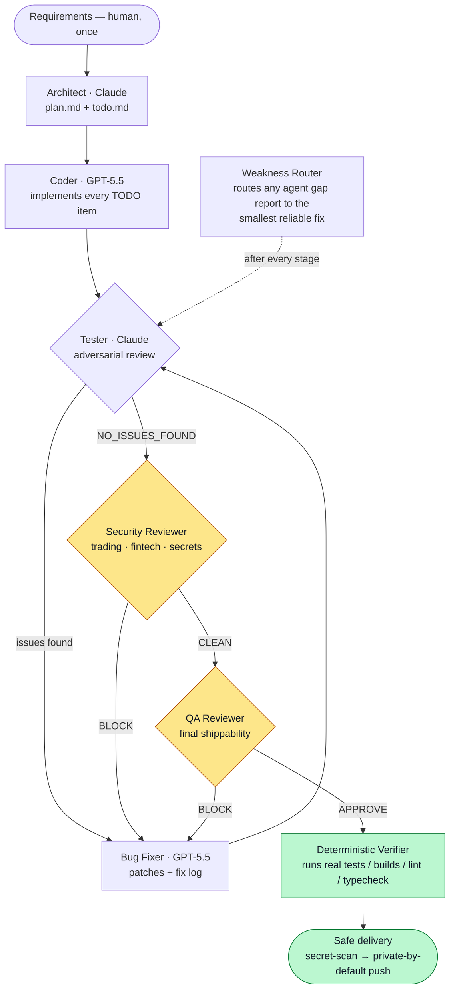

# Multi-Agent Software Development System

**An autonomous software-engineering pipeline that models an entire dev organization as role-separated AI agents — with independent adversarial review, a security gate, a senior QA sign-off, and deterministic verification before anything is called "done."**

A human hands in requirements. Eight specialized agents carry the work through
**plan → code → test → fix → security review → QA sign-off → safe delivery**, with
no human in the loop after kickoff. The system is provider- and runtime-agnostic:
it routes each role to the model best suited to it, and runs three different ways
depending on the environment.

This repository is a working system, not a demo — the other systems in
this portfolio were built and hardened through it, across trading,
document-automation, and web domains.


---

## Why it's built this way

Most "AI writes code" tools are a single model in a loop. That model plans,
codes, and grades its own work — so it confidently ships its own mistakes. This
system is designed the way a real engineering organization is: **separation of
duties, independent review, and objective gates that a single author cannot wave
through.**

| Design decision | Why |
|---|---|
| **Role-separated agents** (architect ≠ coder ≠ tester ≠ reviewer) | An author is the worst judge of their own work. The Tester reviews the Coder's output as an adversary, not a collaborator. |
| **Multi-provider routing** | Claude Opus plans, tests, and reviews; GPT-5.5 (via the Codex CLI) writes and fixes code. Each role runs on the model that is strongest at it, not one model forced to do everything. |
| **Deterministic verification, not vibes** | A verifier actually runs the target project's tests/builds/lint/typecheck and refuses to mark a run "clean" without real passing-command evidence. An LLM saying "looks good" is explicitly not sufficient. |
| **A security gate with teeth** | For trading/fintech/secret-handling projects, a Security Reviewer can `BLOCK` the pipeline on hardcoded secrets, float money-math, missing order idempotency, missing paper-trading mode, or silent failures in risk paths — and rewrites the bug report so the fix happens automatically. |
| **A final senior sign-off** | A QA Reviewer does the last shippability pass (`APPROVE` / `APPROVE_WITH_NOTES` / `BLOCK`) against the original requirements — the "would a staff engineer ship this?" gate. |
| **Graceful uncertainty** | When any agent hits something it can't confidently resolve, it emits a structured *gap report* instead of guessing. A Weakness Router then picks the *smallest* reliable intervention. |
| **Institutional memory** | Corrections are written to a persistent `lessons.md` that every future run reads before acting, so the system stops repeating mistakes. |

---

## Architecture



### The agent roster

| Agent | Model | Responsibility | Output / verdict |
|---|---|---|---|
| **Architect** | Claude Opus | Turn requirements into an unambiguous, traceable spec | `plan.md`, `todo.md` |
| **Coder** | GPT-5.5 (Codex) | Implement every TODO item autonomously | code + `coder_report.md` |
| **Tester** | Claude Opus | Adversarial review — bugs, leaks, perf, security, spec drift | `bug_report.md` |
| **Bug Fixer** | GPT-5.5 (Codex) | Repair the Tester's findings, log each fix | patched code |
| **Security Reviewer** | Claude Opus | Domain security/compliance gate for risk-bearing code | `CLEAN` / `BLOCK` |
| **QA Reviewer** | Claude Opus | Final senior shippability sign-off | `APPROVE` / `BLOCK` |
| **Weakness Router** | Claude Sonnet | Route mid-pipeline uncertainty to the smallest reliable fix | routing ledger |
| **Refactor Architect** | Claude Opus | Plan changes to *existing* codebases (refactor/audit mode) | scoped plan |

Every agent is bound by [`CLAUDE.md`](CLAUDE.md) (engineering standards injected
into each system prompt) and reads [`tasks/lessons.md`](tasks/lessons.md)
(persistent corrections across runs). Trading/fintech projects additionally bind
[`tasks/trading_rules.md`](tasks/trading_rules.md) — mandatory idempotent order
paths, paper-mode flags, decimal money-math, and audit logging.

---

## Deterministic verification (the quality backbone)

The verifier is what separates this from a chatbot that writes plausible code. It:

- **Auto-detects** the target project's real commands across Python and Node —
  `unittest`/`pytest`, `npm`/`yarn`/`pnpm`/`bun` `test`/`build`/`lint`/`typecheck` —
  from lockfiles and project structure.
- **Sanitizes the environment** (clears `PYTHONHOME`/`UV_INTERNAL__PYTHONHOME`,
  resolves the right interpreter and package manager across install locations)
  so verification is reproducible on a messy Windows host.
- **Gates "clean" on evidence**: failures, timeouts, missing executables, and
  *absent* passing-command results all block clean status and become bug-report
  issues. A project with no runnable checks is `not_reviewed`, never `clean`.

This is also the system's built-in eval/review harness: the testing tier plus the
security and QA gates plus deterministic verification form a complete quality
system, not an afterthought.

---

## Three ways to run it

The same standards, artifact layout, and workspace format are shared across all
three, so projects are interchangeable between them.

**1. Native Claude Code** (day-to-day) — subagents + slash commands:
```
/pipeline <requirements>      # full plan→code→test→fix→review→deliver
/refactor <path> <goal>       # change an existing codebase safely
/audit <path>                 # read-only review pass
```

**2. Headless Python orchestrator** (CI / scripted / API-fallback):
```powershell
.\start.bat "Build a CLI todo app in Python with SQLite (add/list/done/delete)."
.\start.bat --requirements-file spec.md --name todo-cli
.\start.bat --resume workspace\todo-cli        # resume an interrupted run
```

**3. Codex-only runner** (when Claude budget is tight):
```powershell
.\start-codex.bat "Build ..."
.\codex-team.ps1 -RequirementsFile spec.md -Name my-project -MaxIterations 3
```

See [NATIVE_PIPELINE.md](NATIVE_PIPELINE.md) for the native flow in detail.

---

## Tech stack

- **Python 3.10+** orchestration (`orchestrator.py`, `verifier.py`)
- **LLM providers:** Anthropic (Claude Opus/Sonnet) + OpenAI/Codex CLI (GPT-5.5),
  routed **per role** with automatic API fallback
- **Runtimes:** native Claude Code subagents, headless Python, Codex CLI
- **Delivery:** git + GitHub CLI with a pre-push secret scan and private-by-default
  publishing

## Repository layout

```
orchestrator.py         # headless pipeline engine
verifier.py             # deterministic verification harness
config.json             # model/provider/iteration/verification config
agents/                 # Python agent classes (architect, coder, tester, bug_fixer, base)
prompts/                # reusable system-prompt templates for each role
native/
  agents/               # native Claude Code subagent specs (incl. security-reviewer, qa-reviewer, weakness-router)
  commands/             # /pipeline, /refactor, /audit
tasks/
  lessons.md            # persistent cross-run corrections
  trading_rules.md      # binding domain rules for fintech projects
tests/                  # the system's own regression tests
```

## Configuration

Model routing, iteration caps, and verification policy live in
[`config.json`](config.json). Coding/fixing is pinned to GPT-5.5 via the Codex
CLI; planning/testing/review run on Claude Opus. API keys are read from the
environment (`ANTHROPIC_API_KEY`, `OPENAI_API_KEY`) — never stored in the repo.

